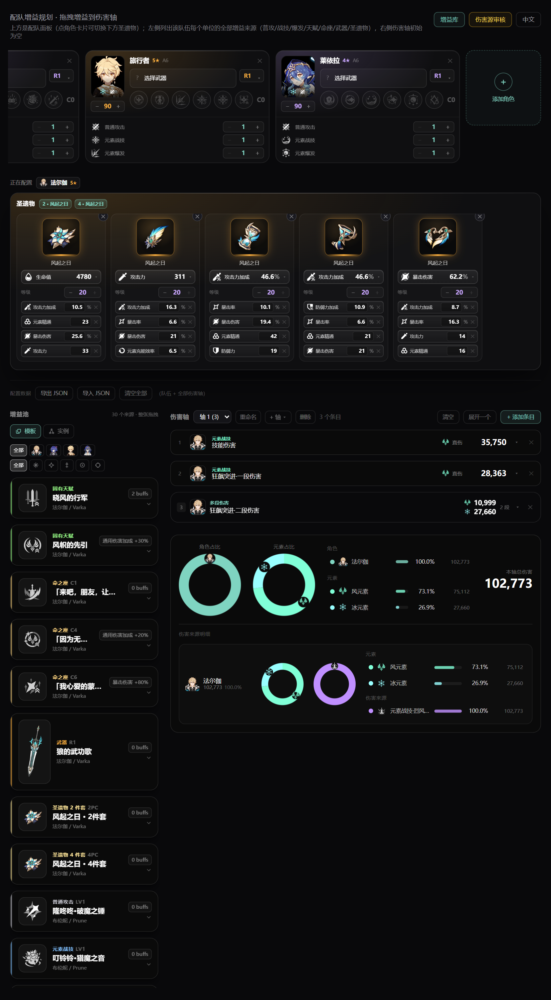
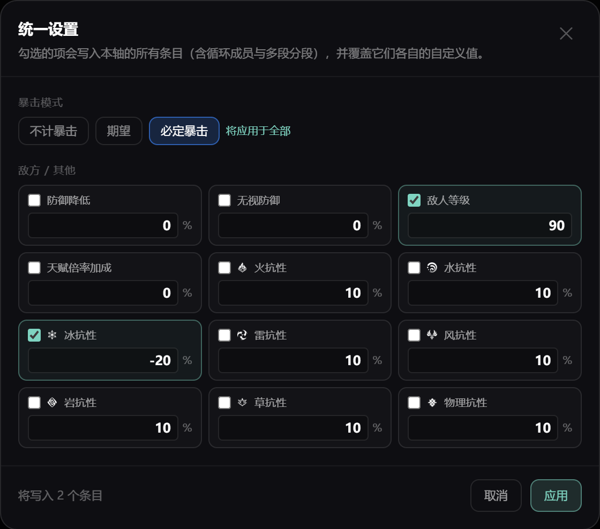

# GS-Plan · 配队增益规划器

对 <https://lunaris.moe/char> 的角色数据做本地固化，在此之上做一个**配队增益规划器**：
139 个角色的真实数据、技能倍率、图标与立绘全部落盘，**运行时不访问外网**；
轴上的每一个伤害都不是抄来的数字，而是由「角色白值 + 武器白值 + 圣遗物 + 拖进来的增益」现场算出来的。

本文只讲规划器。仓库里还有几个**往里填数据的维护页**（增益库、伤害源审核、数值来源），
它们是工具，不是这个项目要展示的东西——来历见文末「数据与素材」。

## 快速开始

```bash
npm install          # 安装依赖
npm run fetch        # 下载数据集与图片（增量、可续传；见 docs/FETCHING.md）
npm run build        # 构建到 dist/（Rollup + Babel + Tailwind，全部进程内完成）
npm run dev          # 启动本地服务
```

仓库**不含**数据集与图片：它们是第三方内容（官方美术、抓取的详情文本），约 135 MB / 10,800 个文件，
由 `npm run fetch` 从源头下载。所以 `npm run fetch` 是**必做的一步**，不是可选的更新。

然后打开 **<http://127.0.0.1:5199/>**（服务根路径直接就是规划器；对应文件是 `planner.html`）。

## 界面

**配队增益规划器** —— 左侧增益池、右侧伤害轴、底部按角色/元素/来源的占比统计：



## 伤害轴

### 一条条目

1. 点「添加条目」新建一个条目
2. 用条目上的下拉框**选择角色**（4 个队员）
3. 选完角色后，条目里出现**真正的 `DamageCard`**，其技能来源与倍率
   **从该角色的真实天赋数据读取**（`/data/char/chs/{id}.json` 的
   `skills.{normalattack,elementalskill,elementalburst}.multipliers`，取 Lv.10）
4. 把左侧整张增益卡拖进去，该卡的**全部增益**累加进数值面板并重新结算
5. 条目可删除，也可「清空」全部

见 `src/char-sources.js`：把角色天赋表转成 `DamageCard` 需要的 `sources`。
所以换角色不是换个名字，而是换一整套真实的技能与倍率。

### 数值面板与白值

条目里可以改 19 项数值，每项可输入、`✕` 归零，右上角整体「重置」；下方是 10 个实时中间量：

> 总生命 / 总攻击 / 总防御 / 天赋倍率 / 反应增幅 / 暴伤区 / 伤害加成 / 防御区 / 抗性区 / 充能效率

**这些数字建立在真实白值上，不是数据集里四舍五入的展示值。** 白值按
`base × 成长曲线(等级) + 突破值(阶)` 现场计算（数据来自游戏配置表），
所以法尔伽 L95 + 狼的武功歌 L90 是 `1000.5489` 而不是 `1000`。
原理、溯源与已知限制见 **[docs/STATS.md](docs/STATS.md)**。出了新角色时：

```bash
npm run stats:update     # 增量拉取上游表并重新打包因子表，会打印新增/变更清单
```

### 元素与反应

**下拉选择**（不是平铺网格），按三类分组：

- **无增幅**：直伤 → 该攻击自身的单个元素图标
- **增幅反应（有方向）**：蒸发 / 融化 → **「触发元素 → 被触发元素」带箭头**，
  因为倍率取决于方向：蒸发 水→火 ×2.0 / 火→水 ×1.5，融化 火→冰 ×2.0 / 冰→火 ×1.5
- **剧变反应（无方向）**：超导 / 扩散 / 感电 / 冻结 / 超载 / 燃烧 / 原激化 / 绽放 / 结晶 →
  **两个元素图标用「+」连接，不加箭头**，因为这类反应伤害与触发顺序无关

**元素伤害加成与物理伤害加成按攻击类型自动分流**：普攻走物理加成，元素战技/爆发走元素加成。

### 伤害公式

```
总生命 / 总攻击 / 总防御 = 基础值 × (1 + 对应加成%) + 对应固定值
天赋倍率 = 技能倍率 × (1 + 命座加成) × (1 + 天赋倍率加成)
增幅倍率 = 反应基础 × (1 + 2.78 × 精通 / (精通 + 1400)) × (1 + 反应伤害提升%)
暴伤区   = 1 + min(暴击率, 100%) × 暴击伤害      （不计暴击为 1；必定暴击为 1 + 暴击伤害）
防御区   = (100 + 等级) / ((100 + 等级) + (100 + 敌人等级) × (1 - 防御降低%) × (1 - 无视防御%))
抗性区   = 1 - (敌人抗性% - 抗性降低%)            （降到 0 以下时收益减半）
伤害加成 = 该元素伤害加成% + 通用伤害加成%        （物理 = 物理伤害加成% + 通用）
单段伤害 = 总攻击力 × 天赋倍率 × (1 + 伤害加成%) × 增幅倍率 × 暴伤区 × 防御区 × 抗性区
```

两点容易写错的地方，这里是刻意的：

- 固定值在百分比**之外**（`基础 × (1+加成%) + 固定值`）。折进基础里会让一个 +20 花的主词条
  也跟着吃 46.6% 生命加成，凭空多出一成。
- 防御降低与无视防御**相乘**，不是相加。相加在两者都大时会算出比「无防御敌人」还高的伤害。

### 多段伤害

一条攻击可以自带多个数字（如 `59.27%+110.08%`），这时条目会拆成**每个数字一个子段**：
子段各有自己的元素、自己的增益、自己的抗性，父段只负责汇总与选技能。

一个子段**不共享父段或兄弟的任何东西**——两半打的抗性不同，一条增益只属于其中一半。
见 **[docs/MULTI-PART.md](docs/MULTI-PART.md)**。

### 循环（segment）

多行可以合并成一个可命名、可折叠的**循环容器**，用来表达「首轮 / 第二轮」这种结构。
成员仍是完整条目，各自保留角色、元素、来源与增益。

### 统一设置

伤害轴顶部可以一次设定**暴击模式 / 敌人等级 / 各元素抗性**，点「应用」写进**所有条目**
（含循环成员与多段分段），并带一次「恢复」回退，不会把旧值弄丢。条目自己的值仍然保留，
随时可以单独改回来。



### 笔记

每个**最小条目单位**（单段、多段里的每个子段、循环成员）都能写一条自己的笔记，
用来记公式之外的东西——「这条是抗性下降后重算的」「带着护盾才算」。点一下即编辑，
`Enter` 保存、`Shift+Enter` 换行、`Esc` 取消，随存档一起保存，复制条目也会带上。

子段写了笔记、父段折叠起来之后看不见，所以**折叠的父段会把下面的笔记汇总出来**
（按段号/成员号编号，完整内容在悬浮提示里），点它直接展开那一行。

## 增益

### 拖的就是整张卡

增益池**不重写样式**——每张卡就是 `BuffCard` 本体（图标主导、收起，悬浮/点击展开）。
拖动的是**整张增益卡**（一个来源），不是一个「攻击力 +28%」的散条目：一把武器带三个效果
是**一件东西**，拆成三个数字拖走，恰好破坏了卡片要表达的那层分组。

落到条目里后渲染的仍是 `BuffCard`——同一个组件，所以拖的是什么，落下来就是什么。
卡片在条目内可编辑（展开改值 / `✕` 删行），改动只属于这个条目。

### 独立性

**在数据结构上保证，而不是靠约定**：每条条目持有自己的卡列表（`drops`），每张卡又持有自己的
buff 数组；拖拽时 `dataTransfer` 里放的是整张卡 + 其 buffs 的 JSON 快照；drop 时**深拷贝**
并生成唯一 `id`，从此与池子、与其他条目都没有引用关系。左侧池子是常量，只读。

实测（Playwright，两张条目同为奥黛塔）：

| 步骤 | 条目0 | 条目1 | 池子 |
| --- | --- | --- | --- |
| 初始 | 153 | 153 | — |
| 拖入「苍狼之牙」（整卡） | **236** | 153 | 不变 |
| 在条目0 的卡里把值改成 99 | **366** | 153 | **不变** |
| 同一张卡再拖到条目1 | 366 | **236**（独立副本，非 366） | 不变 |

### 增益值可以写公式（绑定到角色面板）

一条增益的值**不一定是数字**，也可以是一个引用角色自身属性的小公式：

```
=$总攻击力*0.15        # 该角色总攻击力的 15%
=$生命值*0.02          # 该角色基础生命值的 2%
=($攻击力+$固定攻击力)*0.2
=$元素精通*2.5
```

在可编辑的增益卡里输入 `=$` 会**自动提示符号**，每一项都带**当前数值**——
`$攻击力` 和 `$总攻击力` 只差一个字，看着数值选才不会选错：


**符号表**（由 `DERIVED_KEYS` 自动生成，与面板字段一一对应，不会漂移）：

| 类别 | 符号 |
| --- | --- |
| 面板字段 | `$生命值` `$攻击力` `$防御力` `$固定生命值` `$固定攻击力` `$固定防御力` `$攻击力加成` `$生命值加成` `$防御力加成` `$元素精通` `$暴击率` `$暴击伤害` `$元素充能效率` `$治疗加成`、各元素伤害加成、`$通用伤害加成` `$物理伤害加成` |
| 三项总值 | `$总生命值` `$总攻击力` `$总防御力`（= 基础值 ×(1+加成%) + 固定值） |
| 角色身份 | `$等级` `$命座` `$普通攻击等级` `$元素战技等级` `$元素爆发等级` `$精炼` `$稀有度` |

两条设计约束：

- **作用域是封闭的**：总值在**所有增益折叠之前**、直接由面板算出，
  所以「总攻击力 15%」不会把自己算进去，自引用的公式在结构上就不可能。
- **公式要么算出结果、要么被拒绝**，绝不退化成其中的数字：
  `=$不存在*2` 会提示「不认识的符号」，`12abc3` 不会被读成 `123`。
  无法解析时按 0 生效，并在卡片上标出原因，而不是显示一个看着像对的错数字。

公式读的是**卡片所属角色自己的面板**：从尼可拖到法尔伽条目里的卡，读的仍是尼可的攻击力；
并且是**不含任何增益的裸面板**。

## 圣遗物

### 多套命名配置

每个角色可以保存**多套命名配置**（例如「暴击套」「精通套」）。圣遗物面板标题下是一排标签，
点哪个哪个就**立即生效**——不需要「应用」按钮：

- **点标签 = 使用**。`active` 指针决定当前用的是哪套，角色面板、2/4 件套增益来源、
  `=$` 公式作用域、伤害条目结算全都读同一套，不可能互相不一致。
- **命名与增删**。标签上的 `✎` 重命名、`✕` 删除；「+ 新配置」新建一套并自动切换。
  最后一套不能删（角色总得有一套）。
- **保存即全部**。导出 JSON 会带上每个角色的**全部配置**，导入时完整还原；
  旧格式的单套存档会被自动迁移成一套配置，数值不变。

要计算的不是「哪套最好」而是「换成这套会怎样」时，就是切一下标签。

### 词条合计

五部位右侧实时把当前配置的全部主/副词条按属性累加（生命值/攻击力/暴击率…），
只看圣遗物贡献，不含角色基础值：


## 配置导入导出

配队 + 全部伤害轴导出为 JSON、导入还原，或一键清空。旧存档会被自动迁移。

## 数据与素材

规划器读的每个数字都是本地文件，运行时一次网络请求都不发。

角色、武器、圣遗物那套原始数据和美术（约 135 MB）是第三方内容，没有放进仓库，
用 `npm run fetch` 下载就行（就是上面快速开始里的那一步）。仓库里留下的，只有本项目自己产出的几样东西：

- `public/data/stats-compact.json` —— 白值因子表，`npm run stats:update` 从游戏配置表打包而来
- `public/data/talent-damage.json` —— 伤害源倍率，先在 `audit.html` 里过一遍人工审核再导出
- `data/config/buff-library.json` —— 各来源的增益数值，在 `buffs.html` 里手工填写

后两者所在的页面不是公共界面：官方只给文字描述、不给数值表，这两页就是拿来人工补齐的，
平常用规划器不需要打开它们。

原站前端请求 `https://api.lunaris.moe`，本项目沿用同一套接口，只是把结果直接落到 `public/`：

```
GET /data/version.json                      -> 版本列表（最新 7.1.51）
GET /data/7.1.0/charlist.json               -> 139 个角色：名称、元素、武器、稀有度、90 级属性
GET /data/7.1.0/{lang}/char/{id}.json       -> 单角色详情：天赋倍率、命之座、突破材料（lang = en / chs）
GET /data/assets/gachaicon/{CardImg}.webp   -> 卡片立绘
GET /data/assets/avataricon/{forward}.webp  -> 详情页头像
GET /data/assets/{icons,skills,items}/...   -> 各类图标
```

## 目录结构（规划器相关）

```
├── build.mjs              # Rollup 构建：JSX 用 Babel 编译，CSS 用 Tailwind/PostCSS
├── serve.mjs              # 静态服务器（仅用 Node 内置模块）；/api/data 读写增益库
├── src/
│   ├── planner-main.jsx   # 规划页入口（增益池 + 伤害轴 + 公式作用域的状态持有者）
│   ├── DamageCard.jsx     # 伤害卡片：来源/段数菜单 + 数值 + 元素与反应计算（自包含、可复用）
│   ├── char-sources.js    # 把角色天赋表转成 DamageCard 需要的 sources
│   ├── game.js            # 元素/武器/稀有度映射与图片路径
│   ├── i18n.jsx           # 中英文案与语言 Context
│   ├── components/
│   │   ├── DamageEntry.jsx  # 轴上的一条条目：折叠行 + 展开卡 + 拖放
│   │   ├── EntryGroup.jsx   # 多段伤害与循环容器
│   │   ├── BuffCard.jsx     # 「一个来源 = 一张卡」
│   │   ├── BuffPool.jsx     # 左侧增益池
│   │   ├── EntryNote.jsx    # 条目上的笔记框
│   │   └── buff-model.js    # 增益折叠（foldDrops / 乘区 / mergeStats）
│   └── lib/
│       ├── stat-derive.js      # 由角色/武器/圣遗物推导面板（DERIVED_KEYS）
│       ├── buff-formula.js     # 增益公式引擎：符号表、解析、求值、`$` 补全
│       ├── axis-compute.js     # 整条伤害轴的纯函数推导
│       ├── damage.js           # 单段伤害公式（防御区/抗性区/暴击/增幅）
│       └── rotation-segment.js # 循环容器：合并/展开/扁平化
```

## 关于沙箱：为什么不用 Vite

构建完全在 Node 进程内完成（`build.mjs` 里用 Rollup 的 JS API 调 Babel 与 Tailwind/PostCSS 插件），
不 spawn 子进程——Vite 在这类受限沙箱里会因为探测而挂住。`package.json` 的 `postinstall` 会执行
`scripts/patch-vite.mjs`，用于在**普通环境**下使用 Vite 时跳过它 Windows 端的 `net use` 探测。
若你不在沙箱里，也可以直接用 `npx vite`。

## 验证

伤害轴的所有数字由 `lib/axis-compute.js` **一次推导**，不缓存在组件里：折叠行、展开卡、
底部统计读的是同一个函数，所以它们不可能不一致。配套检查脚本在 `scratch/`：

```bash
node --import ./scratch/register.mjs scratch/check-derive.mjs          # 面板推导
node --import ./scratch/register.mjs scratch/check-buff-formula.mjs    # 公式引擎
node --import ./scratch/register.mjs scratch/check-artifact-totals.mjs # 词条合计
node --import ./scratch/register.mjs scratch/check-consistency.mjs     # 字段口径
```

浏览器侧的检查用 Playwright 驱动本机 Chrome（`scratch/check-*.mjs`）。

## 开发

仓库各页面、模块职责与关键不变量（改代码前先看）见 **[docs/DEV.md](docs/DEV.md)**。

## 说明

本项目仅用于技术学习与研究，数据与图片版权归原站及游戏发行方所有。
